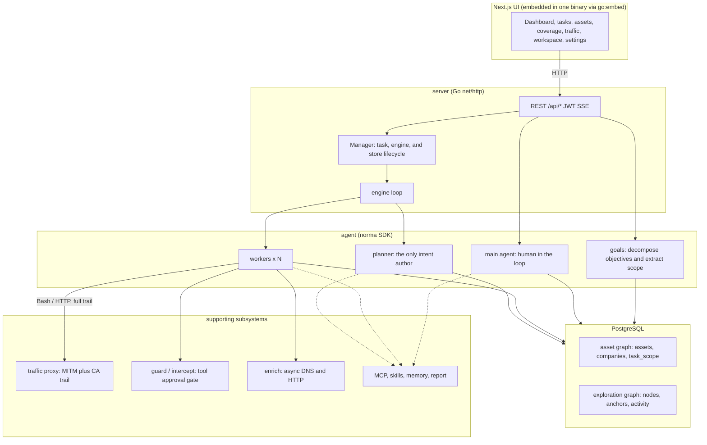
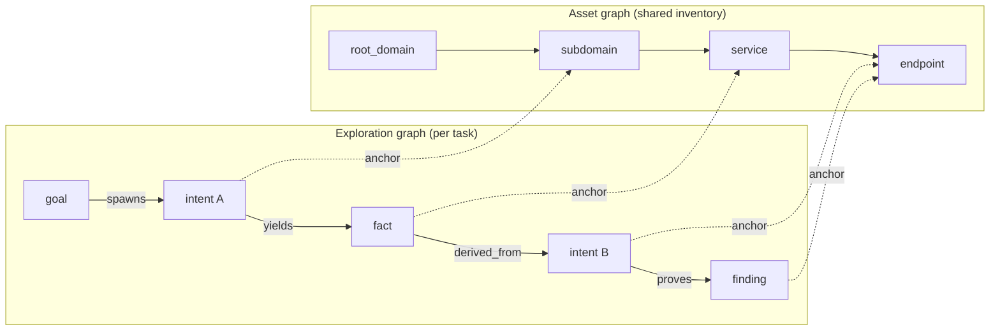
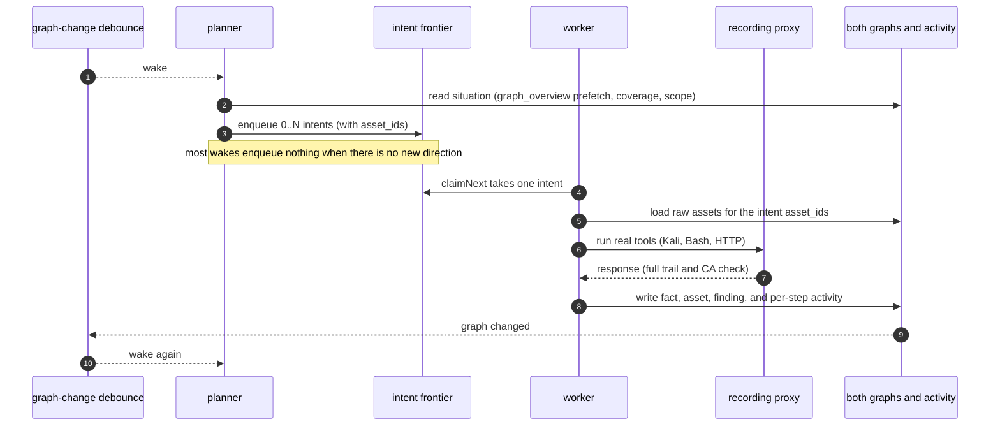
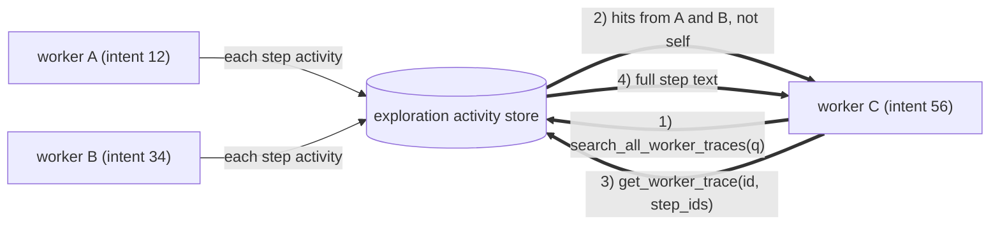
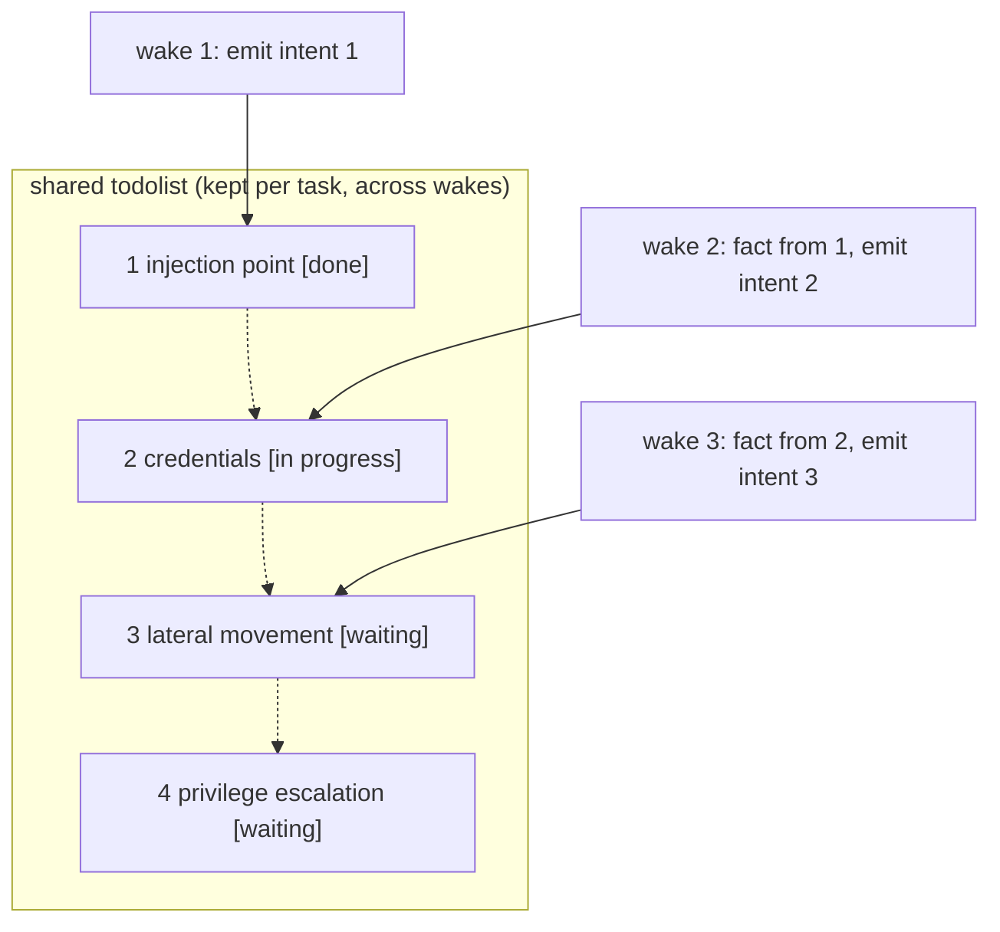

<div align="center">

# ARTEX

Autonomous penetration-testing system (Go backend + Next.js frontend)


Live demo (mock data): [https://artex-demo.mhtsec.com](https://artex-demo.mhtsec.com)

This repository is a source backup of the last ARTEX release. The original Docker image `autumn27/artex` is gone. The image maintained with this tree is `mianhuatang11/artex` on Docker Hub. If the pull fails, run `docker compose build` and build from source. There are no external prebuilt dependencies.

</div>

---

## Screenshots

> Full interaction is on the [live demo](https://artex-demo.mhtsec.com) (frontend only, mock data, no backend).

| Dashboard (overview / token use / activity) | Tasks |
| :---: | :---: |
|  |  |

| Task execution (sessions / tool calls) | Exploration graph |
| :---: | :---: |
|  |  |

| Findings | Assets |
| :---: | :---: |
|  |  |

| Asset coverage graph (force layout, tested nodes highlighted, collapse and expand) |
| :---: |
|  |

| Traffic recording | Human-in-the-loop chat |
| :---: | :---: |
|  |  |

| Agents | LLM settings |
| :---: | :---: |
|  |  |

| Approval intercepts | Backend logs |
| :---: | :---: |
|  |  |


---

## Approval details

Global approval history, in-task intercepts, and approval cards in chat can all expand. The layout follows the [AegisHook approval detail component](https://github.com/RuoJi6/AegisHook/blob/main/web/src/components/CallDetail.vue), using ARTEX components and theme.


## Asset sync (ScopeSentry)

Sync assets from [ScopeSentry](https://github.com/Autumn-27/ScopeSentry) instead of collecting them again:

- On the **Asset sync** page, enter the ScopeSentry URL and API key.
- Pick targets by **project** or **task**, and choose asset types (domain, subdomain, IP, port, site, endpoint, and so on).
- Import once. Assets are merged into company scope and show up on the ARTEX asset graph for agents.

---

## Install

> Requires **PostgreSQL**. Exploration needs an **LLM** (`ANTHROPIC_API_KEY` or `OPENAI_API_KEY`, or a key set in the UI).

### Option 1: install script (recommended)

```bash
git clone https://github.com/ZionLuo/ARTEX.git
cd ARTEX
./install.sh
```

The script detects or installs Docker, then asks you to choose **1) full Docker** or **2) local build**:

- **1) Full Docker**: enter a Postgres password (Enter generates one), write `.env`, then `docker compose up -d`.
- **2) Local**: use an existing database or start one in Docker, write `config.json`, compile a single binary with the UI embedded, and start it.

Open **http://localhost:8787**. The first visit goes to `/setup` to set the admin password.

### Option 2: Docker Compose (manual)

```bash
git clone https://github.com/ZionLuo/ARTEX.git
cd ARTEX
cp .env.example .env          # set POSTGRES_PASSWORD and optionally ANTHROPIC_API_KEY
docker compose up -d          # pull mianhuatang11/artex and postgres
# → http://localhost:8787
```

> The original image `autumn27/artex` was removed from Docker Hub. This tree uses **`mianhuatang11/artex`**.
> If the registry is down, or you want to change the code, build locally: `docker compose build && docker compose up -d`.
> The Dockerfile is multi-stage (static frontend export, static Go build, runtime image). Default dependency mirrors are friendly to networks in China. Override with `--build-arg GOPROXY=...` and `--build-arg NPM_REGISTRY=...`.

The image includes common tools (ripgrep, curl, vim, npm, nmap, and others). `./skills` and `./data` are bind-mounted.

Remote MCP can use `http` (Streamable HTTP) or `sse` (legacy SSE) in system settings.
Legacy SSE servers usually open an event stream with `GET /sse`, then accept JSON-RPC on the returned
`/message?sessionId=...` URL. Set the URL to `/sse` and the header to
`Authorization=Bearer <token>`.

### Option 3: prebuilt binary (Releases)

Download the zip for your platform from [Releases](https://github.com/ZionLuo/ARTEX/releases). If this repository has not published a binary yet, use option 2 or option 4 and build from source. The archive contains `artex`, `start.sh` (`start.bat` on Windows), `skills/`, and `config.example.json`:

```bash
cp config.example.json config.json   # fill in the database connection
./start.sh                           # → http://localhost:8787
```

> Start with `start.sh` / `start.bat`, not `./artex` directly. The script is a supervisor: it decides whether to restart from the exit code, and the [one-click update](#option-1-one-click-update-in-the-ui-recommended) swaps the binary through it. A direct `./artex` process is not restarted after an update.
> Run in the background with `nohup ./start.sh >artex.log 2>&1 &`.

### Option 4: build a single binary from source

```bash
# 1) static frontend export
cd web && npm ci && npm run build:static && cd ..
# 2) copy into the embed directory
cp -r web/out server/webui/dist
# 3) build (the embedui tag embeds the frontend)
CGO_ENABLED=0 go build -tags embedui -o artex ./cmd/artex
./start.sh
```

### Option 5: cross-platform release archives

`build.sh` builds and embeds the frontend, strips debug info with the Go linker, and zips the release files. Release mode builds Linux amd64/arm64, macOS amd64/arm64, and Windows amd64:

```bash
./build.sh --release
# output: dist/artex-0.3.3-*.zip
```

UPX-packed binaries can break on some Linux kernels, hypervisors, or security policies, so UPX is off by default. Set targets with `ARTEX_TARGETS`. Pass `--upx` only when you know the target environment accepts it:

```bash
ARTEX_TARGETS=linux/amd64,windows/amd64 ./build.sh --release
./build.sh --target linux/amd64 --upx
```

---

## Upgrade

> An upgrade replaces the program and keeps data: the Postgres volume `pgdata`, `./data` (jwt.key, SQLite, and so on), and `./skills`. **Do not run migrations by hand.** On every start, `artex` reapplies `schema.sql` idempotently (`ADD COLUMN` / `CREATE INDEX IF NOT EXISTS`). A restart is the migration. Back up `./data` and the database first anyway.

### Option 1: one-click update in the UI (recommended)

On **System settings** (sidebar, `/system/settings`), the **Version and updates** card can check for and install a release without a shell login.

Update downloads the archive for this platform, checks the release `SHA256SUMS`, smoke-tests the new binary with `-h`, stages it as `artex.new`, then exits. `start.sh` / `start.bat` restarts the process and swaps the binary. The page refreshes when the new version is up.

- **A failed check does not leave a broken binary.** A bad checksum or smoke test discards the staged file and keeps the current version. If the new build fails to start three times in a row, it rolls back to `artex.old` and keeps the bad file as `artex.failed`.
- **You can roll back.** The previous binary stays as `artex.old`, and the card has a rollback action. The database schema is not rolled back.
- **An update stops running tasks.** It restarts the process. Do it when the system is idle.
- **Dev builds are not updated.** Versions named `dev`, or `git describe` versions with a suffix, skip updates so a release does not overwrite a local debug binary.
- **Docker updates the binary inside the container, not the image.** Toolchains such as Playwright and nmap stay on the image versions, and `docker compose up -d` recreates the container from the image. To upgrade the image too: `docker compose pull artex && docker compose up -d artex`.
- If GitHub needs a proxy, set the **global proxy** on the same page. Updates download only from GitHub hostnames and force HTTPS.

### Option 2: update script

```bash
cd ARTEX
./update.sh
```

The script can `git pull`, then asks for **1) Docker update** or **2) local rebuild** (same split as `install.sh`):

- **1) Docker**: optional image tag (Enter keeps `ARTEX_TAG` from `.env`, default `latest`), then `docker compose pull` and `docker compose up -d`. The new container migrates on startup.
- **2) Local**: rebuild the static frontend and `./artex`. Restart the process to pick it up.

### Option 3: Docker Compose (manual)

```bash
cd ARTEX
git pull                       # update compose files and scripts (optional)
# pin a version with ARTEX_TAG=v0.2.0 in .env; otherwise latest
docker compose pull artex
docker compose up -d artex     # new image restarts and migrates the schema
docker image prune -f          # drop old images (optional)
```

### Option 4: prebuilt binary (Releases)

Download the new zip from [Releases](https://github.com/ZionLuo/ARTEX/releases), stop the old process, replace `artex` and `skills/` (keep `config.json` and `data/`), and start again:

```bash
cp -r <extracted>/skills ./ && cp <extracted>/artex ./
./start.sh
```

### Option 5: build from source

```bash
git pull
cd web && npm ci && npm run build:static && cd ..
cp -r web/out server/webui/dist
CGO_ENABLED=0 go build -tags embedui -o artex ./cmd/artex
# restart ./start.sh
```

---

## Configuration

**Database** (`config.json`, or override with `ARTEX_PG_DSN`):

```json
{
  "database": {
    "host": "127.0.0.1", "port": 5432,
    "user": "artex", "password": "yourpass",
    "dbname": "artex", "sslmode": "disable"
  }
}
```

**LLM**: `export ANTHROPIC_API_KEY=sk-...` (or `OPENAI_API_KEY`), or fill in the LLM page in the UI.
Optional: `ARTEX_LLM_PROVIDER` / `ARTEX_LLM_MODEL` / `ARTEX_LLM_BASE_URL` / `ARTEX_LLM_PROXY`.

**Concurrency**: work agents per task are set in System settings (default 3).

**Common flags**: `./start.sh -addr :8787 -proxy :8788` (`-addr` is the UI and API, `-proxy` is the traffic-recording proxy). The start script forwards flags to `artex` unchanged.

### Reverse proxy (HTTPS, public port 443 only)

The UI, API, and SSE all come from one backend port (default `:8787`). The live activity stream uses the **same origin**, so **`NEXT_PUBLIC_SSE_BASE` is not required**. Expose only 443 and keep 8787 on the private network.

SSE is a long-lived stream. The proxy **must disable buffering**, or the browser connects and never receives events (the activity view keeps spinning). Nginx example:

```nginx
server {
    listen 443 ssl;
    server_name your.domain.com;
    # ssl_certificate / ssl_certificate_key ...

    location / {
        proxy_pass http://127.0.0.1:8787;
        proxy_set_header Host $host;
        proxy_set_header X-Forwarded-Proto $scheme;

        # SSE: no buffering, long timeout, HTTP/1.1
        proxy_buffering off;
        proxy_cache off;
        proxy_read_timeout 3600s;
        proxy_http_version 1.1;
        proxy_set_header Connection "";
    }
}
```

> Set `NEXT_PUBLIC_SSE_BASE` at **build time** only when SSE must use a different origin than the page (for example a separate subdomain). `next build` bakes the value into the static bundle. Setting it later on a running container does nothing.

---


## Development

### Manual vulnerability retest

The **Retest** tab on a task can page through that task's findings, show past conclusions and evidence, and start a retest. After it starts, the tab stays open and shows a spinner and "Retesting". A confirmed fix updates the finding status.

Use **Retest** on a finding row, or **Start retest** in the finding detail. Optional fields cover the fix version, test conditions, or limits. The system creates a separate retest agent session and keeps the current page. Flat lists, task groups, and the asset view all have this action. While it runs, the row shows a spinner and "Retesting"; open the session if you want the trace. When it finishes, the button returns to "Retest". You do not restart the original scan. Conclusions are "still reproducible", "fixed", or "inconclusive". Each run stores the conclusion, evidence, and session link on the finding.

The first start of this backend seeds an editable **vulnerability retest** (`retester`) agent. Configure its prompt, LLM, budget, and tools in Agent management. It uses its bound LLM, or the globally active config if none is bound. When a retest session finishes with "fixed", the finding disposition becomes "fixed". In-progress, failed, stopped, and other conclusions leave the status unchanged. Original evidence and reports stay. You can also set "fixed" from the status menu. A finding that is already retesting reuses that session. After a stop, a failure, or a process restart, you can start again.

History in this version is the finding detail and the session. It is not in exported finding reports or task archives, and it is not linked to traffic captures automatically. Demo mode writes clearly marked mock records and does not contact real targets.

### Local run and tests

```bash
./dev.sh    # backend (:8787) + traffic proxy (:8788) + next dev (:5173) → http://localhost:5173
```

- Backend: `go run ./cmd/artex` (without `-tags embedui` the frontend is not embedded)
- Frontend: `cd web && npm run dev` (`/api` is proxied to the backend, with hot reload)
- Tests: `go test ./...`
- Mock preview (no backend): `cd web && NEXT_PUBLIC_MOCK=1 npm run dev`
- Redeploy the live demo (Cloudflare Pages, static export, mock data):
  ```bash
  cd web && NEXT_PUBLIC_MOCK=1 npm run build:static
  CLOUDFLARE_API_TOKEN=<token> npx wrangler pages deploy out --project-name=artex-demo --branch=main
  ```

---

## Architecture

ARTEX is an **LLM multi-agent autonomous penetration system**: a Go monolith (embedded Next.js UI) plus PostgreSQL. Agent behavior comes from the [`norma`](https://github.com/Autumn-27/norma) SDK (`agentcore`, `tool`, `permission`, `harness`, `memory`, `transcript`). The core is a **two-graph design**, plus two autonomy mechanisms: **process-level information sharing between workers** and a **planner todolist shared across turns** that keeps an attack chain stable.

### Layers



| Layer | Role |
| --- | --- |
| **UI** | Next.js static export, embedded with `go:embed`. Tasks, assets, exploration, coverage, and human-in-the-loop chat. |
| **server** | `net/http` routes, JWT, SSE. `Manager` owns tasks, engines, and DB stores. |
| **engine** | One `plannerLoop` and N worker goroutines per task. Claim intents, timeouts, pause, and drain. |
| **agent** | goals, planner, worker, main agent. `ToolSet` exposes both graphs as LLM tools. |
| **db** | Both graphs in Postgres (pgx). Embedded `schema.sql` is applied idempotently on startup. |
| **support** | Recording MITM proxy, approval gate, async enrichment, MCP, skills, memory, reports. |

### Two graphs: exploration and assets

The system splits **what the target is** from **how far testing has gone**. The graphs are independent and joined by anchors:

- **Asset graph (shared globally)**: one asset inventory across tasks. Node kinds are `root_domain`, `subdomain`, `ip`, `service`, `app`, and `endpoint`, owned by a company. Parent links and dedupe keys are computed by the program. Agents submit raw observations only.
- **Exploration graph (one per task)**: how that task thought and moved. Node kinds are `goal`, `intent`, `fact`, `finding`, and `hint`. Edges such as `spawns`, `derived_from`, `yields`, and `proves` form a lineage: which direction came from which facts, and what it produced.
- **Anchors join them**: `exploration_anchors(node_id, asset_id)` pins an intent, fact, or finding to an asset. You can go from a direction to the assets it hit, or from an asset back to the intents and facts in this task. That is the basis of **test coverage** and the **coverage graph** (in-scope assets, tested ones highlighted).



> Split of work: the **planner** reads the exploration graph, judges goals, and enqueues an **intent** only when there is an uncovered direction. A **worker** claims **one intent**, runs real tools, writes assets, facts, and findings, then stops. The asset graph is shared fact. The exploration graph is that task's chain of progress.

### Engine and intent lifecycle

The engine is event-driven. A graph change wakes the planner. The planner emits intents. A worker claims one, runs it, and writes back. The write wakes the planner again, until a goal is proved (`prove_goal`).



### Process-level sharing between workers

Useful observations (an error, a response fragment, a hidden parameter) often appear in a worker's **execution trace** and never become a formal fact. Workers can search other workers' traces in the same task so later steps do not repeat that work:

- `search_all_worker_traces(q)`: keyword search across **other works in this task**. The current intent's own steps are excluded. Hits include `intent_id`.
- `list_worker_traces` / `get_worker_trace(intent_id, step_ids=[...])`: list works, then fetch the full text of selected steps.

A later worker can reuse an observation before it exists as a fact. Information moves at the granularity of an execution trace. Each worker still executes only the intent it claimed.



### Shared planner todolist and a stable attack chain

A real chain is an ordered sequence (find an injection, obtain credentials, move laterally, escalate). Emitting every step in parallel makes a mess. The planner keeps a **per-task todolist that survives across wakes**:

- The planner is event-driven. Each wake is a **new session**. The shared list records a serial chain once, then emits the next intent when its dependency is met, instead of unfolding the whole chain in one turn.
- A turn emits an intent only for a step whose predecessors are done and whose required facts exist. The list is updated as facts satisfy steps.



The chain still advances in order under event-driven, stateless sessions. That is how ARTEX walks a multi-step chain on its own.

---

## References

https://github.com/oritera/Cairn


## License and disclaimer

### License

This project is licensed under the **GNU Affero General Public License v3.0 (AGPL-3.0)**. The full text is [LICENSE](LICENSE) in the repository root.

You may use, modify, and distribute it, but **derivative works must also be licensed under AGPL-3.0**. In particular, **if you modify this project and provide it to users over a network (for example as an online service), you must make the corresponding complete source available to those users**.

> The license does not restrict what the software may be used for. The use limits and disclaimer below are additional terms from the author. Follow them.

**ARTEX is for personal study, source research, and local technical verification only. Do not use it to test any live system or website.**

### Allowed use

- Reading, studying, and researching this source, and verifying technical behavior in a **local isolated environment**.
- Personal learning, academic research, and code review that is not an attack.

### Prohibited use

- **Do not scan, probe, exploit, or attack any website, online service, or networked system** with this tool, whether or not you have authorization and whether or not you own the asset.
- Do not use this tool for a real penetration test, an offensive exercise, or a production environment.
- Do not use this tool for unauthorized access, data theft, extortion, denial of service, or any destructive or criminal activity.
- Do not use this tool to break the laws of your country or region.

### Compliance

You are responsible for complying with laws on network security, data protection, and computer crime where you are (in mainland China this includes, among others, the Cybersecurity Law, the Data Security Law, the Personal Information Protection Law, and related judicial interpretations). **You bear all legal responsibility and consequences of using this tool.**

### Disclaimer

This project is provided **AS IS**, without warranty of any kind, express or implied. The authors and contributors are not liable for any direct or indirect loss, data loss, system damage, or legal dispute arising from use of this tool, whether or not the use was appropriate. **Downloading, installing, or using this project means you have read, understood, and agreed to all of the terms above.**
